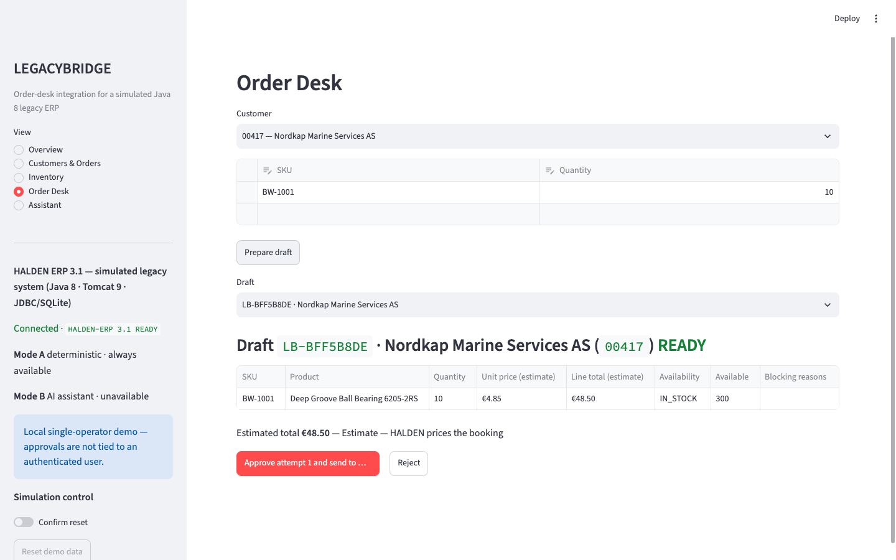
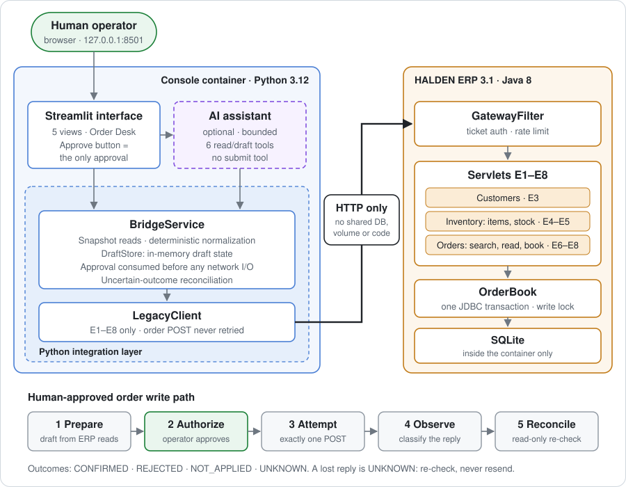
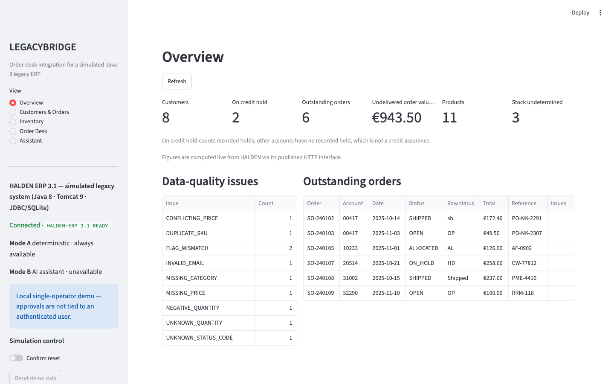
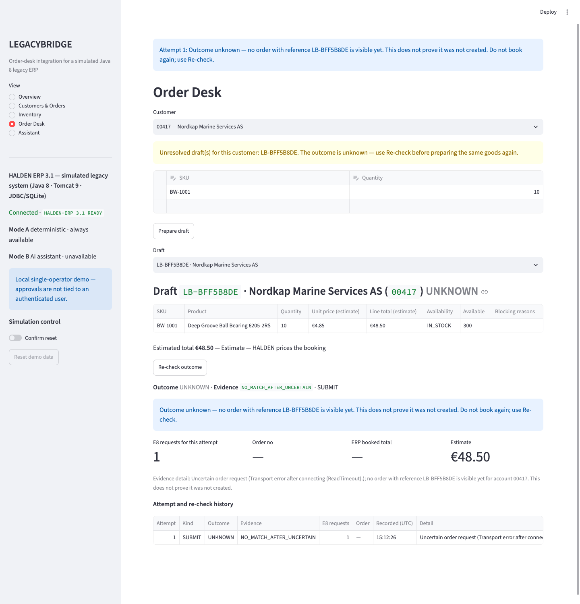

# LEGACYBRIDGE

**Modernizing legacy ERP workflows without replacing the system of record.**

LEGACYBRIDGE is a simulated Forward Deployed Engineering (FDE) engagement: modernizing the order-management workflows of a fictional industrial distributor without replacing its legacy ERP.

Version 1.0 is a functional Python/Streamlit proof of concept that integrates with a simulated Java 8 ERP through a strict HTTP boundary. It demonstrates human-authorized order submission, deterministic normalization of inconsistent enterprise data, and reconciliation of uncertain transactions without blind retries. It ships with a local demonstration environment, deterministic integration tests, and an optional AI assistant restricted to read-only operations and draft preparation.

The Streamlit console represents the initial client-demonstration phase: a working solution of the kind presented to a prospective client to illustrate the proposed workflows and expose integration constraints. A full-scale flagship implementation would be a separate, future phase.

> **Simulated engagement, real engineering.** The client, *Brightwater Industrial Supply*, and all of its people, accounts and figures are fictional. *HALDEN ERP 3.1* is a purpose-built Java 8 legacy-system simulator, not a real product. The integration code, tests and recorded results are real. No real client deployment, commercial validation or production implementation is claimed.



## Engineering highlights

| Capability | How it is enforced | Evidence |
|---|---|---|
| **Strict HTTP-only legacy boundary** | Two containers with no shared volume, database or code. `httpx` is imported only in the legacy client; the Python package never imports `sqlite3` or opens database files. | `tests/test_boundaries.py` |
| **Deterministic normalization** | Pure functions turn mixed date formats, decimal commas, `J`/`nein` flags, duplicate SKUs and unreadable quantities into typed models. Uncertain stock is `UNDETERMINED`, never a guess. | 57 normalization tests |
| **Human-approved order submission** | Only the operator's approve button creates an approval. It is consumed atomically before any network I/O, and draft IDs are allocated uniquely, so an approval always refers to the content that was reviewed. | Race tests repeated 20×; `tests/test_draft_integrity.py` |
| **At most one order POST per approval** | The transport has `retries=0` and no redirects. Timeouts, 5xx replies and authentication failures never trigger a second order POST. | Order-POST counts at the HTTP transport in the test suites |
| **Uncertain-outcome reconciliation** | A lost reply is `UNKNOWN`, not `FAILED`. The only permitted action is a read-only re-check, serialized per draft; account, reference and lines must all match before `CONFIRMED`. | 92 draft state-machine tests; live tests; [recorded run](#failure-recovery-demonstration) |
| **Bounded assistant tool access** | Six read/draft tools and no submit tool. Static tests forbid the assistant code from referencing submission or simulator functions. | `tests/test_assistant.py` |
| **Reproducible validation** | Docker Compose, exact pins and a lock file; the Java contract tests run inside the image build. | [Testing & verification](#testing--verification) |

These invariants are enforced in code and exercised by tests within the single-process demo. They are **not** production guarantees: the project does not claim exactly-once execution, idempotency or authenticated approvals.

## Architecture



| Owned by the legacy system (Java) | Owned by the integration (Python) |
|---|---|
| Customer, item, stock and order records; schema and seed | HTTP communication, tickets, read retries, pagination |
| Business validation, order numbering, allocation | Normalization of raw values into typed models |
| Wire formats, status codes, auth, rate limit | Workflows, human approval, outcome evidence, UI and tools |

**The order write path keeps five steps apart**, because an attempted order request is not proof of an ERP-side effect:

1. **Prepare.** The operator, a guided scenario or the assistant creates a draft from current ERP reads. Nothing is written to HALDEN.
2. **Authorize.** Only the operator's approve button creates an approval for one draft and one attempt. It is consumed before any network I/O.
3. **Attempt.** The client hands exactly one order POST to the HTTP transport.
4. **Observe.** An accepted reply is read back to confirm it; a business rejection is `REJECTED`; a request that provably never reached order processing is `NOT_APPLIED`. A lost or ambiguous reply triggers reconciliation, and if that cannot confirm the order, the outcome is `UNKNOWN`.
5. **Reconcile.** From `UNKNOWN`, read-only re-checks search HALDEN for the draft reference. Only a full match of account, reference and lines confirms the booking.

Details: [docs/ARCHITECTURE.md](docs/ARCHITECTURE.md) · [docs/LEGACY_API.md](docs/LEGACY_API.md).

### The integration problem

The fictional distributor keeps HALDEN as its system of record and builds a safer order-desk workflow around HALDEN's existing HTTP interface instead of replacing it. Three problems make this non-trivial:

- **Which account?** "Alder & Finch" exists twice, and one account is on credit hold. The console lists both and never auto-picks.
- **What can safely be offered?** The ERP's availability flag disagrees with warehouse balances, one SKU exists as two item records with conflicting prices, and some quantities are unreadable. The console flags these as data-quality issues and withholds verdicts it cannot support.
- **Did the booking happen?** The reply to an order request can be lost after HALDEN has committed the order, and HALDEN has no idempotency. A blind retry could book the goods twice.

HALDEN's simulated constraints include a shared service ticket (a new login revokes the previous one), an XML item master where a missing element differs from an empty one, business errors returned with HTTP 200, and a free-text, non-unique, 12-character reference field.

## Core engineering decisions

| Decision | Reason |
|---|---|
| Java 8 servlets on embedded Tomcat 9, JDBC over SQLite, no framework | The legacy side targets the platform such a system would plausibly have been written for. |
| Frozen legacy contract | The Java system was built first, verified by 23 contract tests, reviewed, and frozen by a file manifest and image ID. The integration was built against it; legacy defects go back to the legacy side as separate, reviewed changes and are never patched from Python. |
| One human approval, one order POST | The assistant and guided scenarios only prepare drafts. Once the POST is handed to the transport, the approval is consumed, whatever the response. |
| A missing order is not "not applied" | `NOT_APPLIED` needs positive evidence that HALDEN did not process the request. Absence after an uncertain send is `UNKNOWN`, resolved only by read-only re-checks: resending could double-book, reading cannot. |
| The reference is a correlation key, not an idempotency key | HALDEN's only reference field is free text and non-unique; the draft ID written there is used for reconciliation only. |
| Serialized draft state | Draft-ID allocation and insertion happen under one lock with at most 8 candidate draws. A per-draft lock serializes re-checks without holding the store lock during network I/O, so an older re-check cannot be recorded after a newer confirmation. |
| Complete-snapshot identity, strict stock evidence | Every product view uses one complete catalogue read; one malformed stock row withholds availability rather than allowing a confident wrong verdict. |
| Deterministic demo first, optional model second | The full demo runs without any AI model or API key. |
| Streamlit for the initial client demonstration | Provides a functional interface for demonstrating the integration workflows and evaluating technical constraints without committing prematurely to the architecture or development cost of a flagship application. |

All ten decision records, with trade-offs: [docs/ENGINEERING_DECISIONS.md](docs/ENGINEERING_DECISIONS.md).

## Engineering Challenges & Lessons Learned

### The gateway authorized one path and dispatched another

**Challenge.** HALDEN's `GatewayFilter` lets only `/halden/ping`, `/halden/session` and the `/_sim/*` test-control plane bypass ticket authentication, rate limiting and fault injection. It made that decision on the raw request URI.

**Root cause.** `getRequestURI()` returns the path exactly as sent. Tomcat normalizes the path (resolving `..`, collapsing repeated slashes) before selecting a servlet. Security classification and servlet dispatch could therefore see different paths for the same request: sent without a ticket, `POST /_sim/../halden/orders` matched the `/_sim/` bypass, was dispatched to the order servlet as `/halden/orders`, and booked an order with HTTP 200. The existing gateway tests used canonical paths only, where both representations are identical.

**Fix.** Classify every request, including fault matching, on the servlet dispatch path. `GatewayFilter.java` was the only production file changed.

```java
// Before: classification used the raw request line
if (bypassesGateway(req.getRequestURI()) || allowed(req, res)) { chain.doFilter(req, res); }

// After: classification uses the path Tomcat dispatches
private static String dispatchPath(HttpServletRequest req) {
    String pathInfo = req.getPathInfo();
    return pathInfo == null ? req.getServletPath() : req.getServletPath() + pathInfo;
}
String path = dispatchPath(req);
if (bypassesGateway(path) || allowed(req, res, path)) { chain.doFilter(req, res); }
```

**Verification.**

- Before the fix, the 21 existing Java contract tests passed and the two new regression tests in [`GatewayRouteClassificationContractTest`](legacy-erp/src/test/java/com/brightwater/halden/GatewayRouteClassificationContractTest.java) failed with `expected:<401> but was:<200>`. They send 13 non-canonical spellings with simulation control on and off.
- After the fix, all 23 contract tests passed, and the `curl --path-as-is` checks in [`http_acceptance.sh`](legacy-erp/acceptance/http_acceptance.sh) passed.
- A separate project-internal review exercised additional non-canonical paths, including percent-encoded and path-parameter forms.

**Lesson.** Security decisions must use the same canonical representation as the component executing the request, and tests must include non-canonical inputs to reveal a disagreement.

**Scope.** This was a defect in the fictional local simulator, found before the legacy system was frozen. Common HTTP clients, including `httpx`, normalize these paths, so the Python integration never sends them.

## Features & workflows

| Workflow | What the clerk gets |
|---|---|
| Customer Operations | Search by name or account with no auto-picking of ambiguous matches; customer card with credit-hold badge, orders, outstanding filter and total-mismatch warnings |
| Inventory Intelligence | Catalogue from one complete item snapshot; IN_STOCK / OUT_OF_STOCK / UNDETERMINED with explanation; raw-vs-normalized warehouse table |
| Order Management | Prepare → review → Approve or Reject → CONFIRMED / REJECTED / NOT_APPLIED / UNKNOWN, with evidence and the permitted next action |

The console has five views: Overview, Customers & Orders, Inventory, Order Desk and Assistant.



- **Guided scenarios (Mode A, default).** Seven deterministic scenarios run real business operations against the Java ERP with no AI model. They never submit; a pending draft is approved only with the console's own approve button. See [docs/DEMO.md](docs/DEMO.md).
- **Optional AI assistant (Mode B).** A LangChain assistant with six tools to look up customers, orders, products and availability, and to prepare an order draft. **It can prepare drafts but cannot submit orders.** Real-model behavior has not been evaluated: the automated tests use a scripted model and show only that the wiring and tool boundaries work.

## Failure recovery demonstration

A recorded run (2026-11-20 UTC) using simulated fault injection against the real Java ERP. The next `POST /halden/orders` was delayed by 2500 ms while the integration used a 1.0 s client timeout; the integration did not read simulator state, and a recording HTTP transport provided the order-POST counts.

| Time (UTC) | Integration-visible observation |
|---|---|
| 15:11:21.377 | Operator request: book 10 × BW-1001 for Nordkap Marine (00417) |
| 15:11:21.407 | Draft `LB-07C49519` READY, estimate €48.50; approval attempt 1 |
| 15:11:22.415 | Order POSTs handed to the transport: **1**; observation `UNCERTAIN` (ReadTimeout) |
| 15:11:22.415 | First reconciliation: **UNKNOWN / NO_MATCH_AFTER_UNCERTAIN**. No order with reference LB-07C49519 is visible yet, which does not prove it was not created. Permitted action: **Re-check only** |
| 15:11:25.444 | Re-check after 3 s: **CONFIRMED / RECONCILED SO-240111**; order POSTs still **1** |
| 15:11:25.471 | ERP evidence: order SO-240111 (account 417, ref LB-07C49519, BW-1001 × 10, total 48.50); BW-1001 stock in DUS allocated 10; exactly one order carries the reference |

**Why not send the order again?** The first request may already have committed, and HALDEN has no idempotency, so a second POST could book the goods twice. A confirmation means the order exists in HALDEN; it is not a delivery promise.



The screenshot comes from the real console with a similar setup (default 5 s timeout, 8000 ms delay), so its draft ID differs from the trace.

## Quick start

**Prerequisites:** Docker with Docker Compose v2 and BuildKit; free local ports 8090 and 8501; internet access for the first build, which also runs the Java contract tests.

```bash
git clone https://github.com/EloiRamos/legacybridge.git
cd legacybridge
docker compose up --build
```

Open the console at http://127.0.0.1:8501. HALDEN answers at http://127.0.0.1:8090/halden/ping. Both ports bind to `127.0.0.1` only. Use **Reset demo data** in the sidebar (confirm with the toggle) before each walk-through; see [docs/DEMO.md](docs/DEMO.md).

**Optional Mode B** requires a model-provider API key, billed by the provider:

```bash
cp .env.example .env    # then set ANTHROPIC_API_KEY=... in .env (never commit .env)
docker compose up --build
```

**Stop and clean up:**

```bash
docker compose down
docker image rm legacybridge/console:1.0 legacybridge/halden-erp:3.1   # optional: remove the built images
```

## Testing & verification

The Python tests use [uv](https://docs.astral.sh/uv/).

| Suite | Command |
|---|---|
| Java contract tests (run by `mvn verify` inside the image build) | `docker build legacy-erp` |
| Python offline tests | `uv run pytest -m "not live and not ordinary"` |
| Python offline + live tests (simulation control on) | `docker compose up -d legacy-erp`, wait until http://127.0.0.1:8090/halden/ping answers, then `uv run pytest` |
| Ordinary path (fresh ERP with simulation control off) | `docker compose down`, then `HALDEN_SIM_CONTROL=false docker compose up -d legacy-erp`, wait for the ping, then `uv run pytest -m ordinary tests/test_ordinary_path.py` |

**Recorded results** (2026-11-20, local Docker on macOS arm64; other platforms have not been tested):

| Validation | Result |
|---|---|
| Java contract tests | 23 passed |
| Python offline tests | 232 passed (74 deselected) |
| Python offline + live tests | 300 passed (6 ordinary-path tests deselected) |
| Ordinary-path tests | 6 passed |
| Draft-integrity regression tests | 27 passed |

**Testing strategy.** Deterministic offline tests run against an in-memory HALDEN fake; live tests run against the real Java ERP. Concurrent approvals, replays and re-checks are exercised with scripted, deterministic thread interleavings, and faults such as delayed replies, timeouts and HTTP 500 after commit are injected through the in-memory fake and the simulator's control plane. The tests count order POSTs at the HTTP transport; the console's "E8 requests for this attempt" figure is the service's attempt record, not a network measurement.

## Technology stack

- **Legacy ERP:** Java 8, embedded Apache Tomcat 9, JDBC, SQLite.
- **Integration:** Python 3.12, httpx, Pydantic.
- **Interface:** Streamlit.
- **Optional AI:** LangChain with the Anthropic model-provider integration.
- **Testing:** pytest, JUnit.
- **Infrastructure:** Docker Compose, uv.

Exact versions are pinned in [`pyproject.toml`](pyproject.toml), [`uv.lock`](uv.lock) and the legacy build ([`legacy-erp/pom.xml`](legacy-erp/pom.xml), [`legacy-erp/Dockerfile`](legacy-erp/Dockerfile)).

## Scope & limitations

Version 1.0 is a tested proof of concept running as a local demonstration, not a production deployment: one JVM, one SQLite file and one console process, used by a single trusted operator on loopback ports.

### From demonstration to flagship

**Implemented in v1.0:** a functional Streamlit console, the simulated Java 8 ERP, real HTTP integration, human-approved order submission, deterministic normalization, uncertain-outcome reconciliation, automated tests and a local demonstration environment.

**Not implemented: a potential future flagship.** A flagship would be a separate phase requiring its own requirements discovery, architectural decisions and engineering. Relevant considerations include individual authentication and authorization, durable workflow and reconciliation state, multi-user operation, operational monitoring, production deployment and recovery, integration with a real customer's systems, and performance and reliability validation. None of these has been designed, approved or built.

### Architectural trade-offs

| Choice | Benefit | Cost |
|---|---|---|
| In-memory draft state | No database; simple, testable locking | A console restart loses drafts, attempts and history, including `UNKNOWN` work; the operator must then search HALDEN by reference |
| Draft ID as correlation key in HALDEN's reference field | Works with the ERP as it is | No idempotency; a historical order with the same reference (32 random bits), account and lines could falsely corroborate a booking; a customer PO reference cannot be carried and must be booked in HALDEN directly |
| Single process, single operator | Simple concurrency model | Drafts are shared by all browser sessions; an approval is a click by whoever operates the console, not an authenticated individual approval |
| Simulation control plane (`/_sim/*`) | Deterministic fault injection for demos and tests | It bypasses HALDEN's ticket checks; set `HALDEN_SIM_CONTROL=false` to remove it |

### Known limitations

- **Simulated engagement.** The client, the ERP and all data are fictional. The project has not been deployed for a real client and establishes no commercial outcome, productivity gains, time savings or duplicate-prevention rates.
- **No production validation.** No multi-process or multi-user operation, no production-scale performance testing, and concurrency is tested with scripted interleavings rather than real network timing.
- **Not exactly-once.** At most one POST per approval is enforced; exactly-once execution and idempotency are not claimed.
- **Uncertain outcomes need care.** While a draft is `UNKNOWN`, the console warns but does not block preparing a separate draft for the same goods; approving it could book the goods twice if the original request committed. Resolving a persistent `UNKNOWN` is a manual process.
- **Process-local IDs.** Draft IDs are unique only within one console process and can recur after a restart or demo reset.
- **Reset during in-flight operations is unsupported.** The in-flight approval or re-check can fail, and if a new draft then receives the same ID, the old operation's result can be recorded on the new draft.
- **Assistant.** Real-model behavior has not been evaluated.
- **Business semantics.** "Available" means free units in HALDEN's allocation pool (pooled across the DUS and MAN warehouses) at read time, not a delivery date or reservation. Draft prices are estimates; the booked price is reported, not verified.
- **Network assumptions.** `NOT_APPLIED` on a connection error assumes no intermediary proxy, and this design has none. Ports bind to loopback but remain reachable by other local users and processes; do not expose them to a network.

## Authorship & AI-assisted development

**Elói Ramos** — Project author, architecture, engineering direction, and technical oversight.

LEGACYBRIDGE was developed using AI-assisted engineering tools across implementation, testing, and documentation.

## Documentation

- [docs/ARCHITECTURE.md](docs/ARCHITECTURE.md) — system boundary, ownership, evidence taxonomy, draft state machine, late-commit timeline
- [docs/ENGINEERING_DECISIONS.md](docs/ENGINEERING_DECISIONS.md) — ten decision records with trade-offs
- [docs/LEGACY_API.md](docs/LEGACY_API.md) — HALDEN's published HTTP contract, write semantics and invariants
- [docs/DEMO.md](docs/DEMO.md) — featured walk-through, seven guided scenarios, unevaluated Mode B prompts
- [legacy-erp/README.md](legacy-erp/README.md) — building, running and testing the legacy system on its own

## License

Licensed under the Apache License, Version 2.0 (SPDX: `Apache-2.0`). See [LICENSE](LICENSE).

Copyright 2026 Elói Ramos
